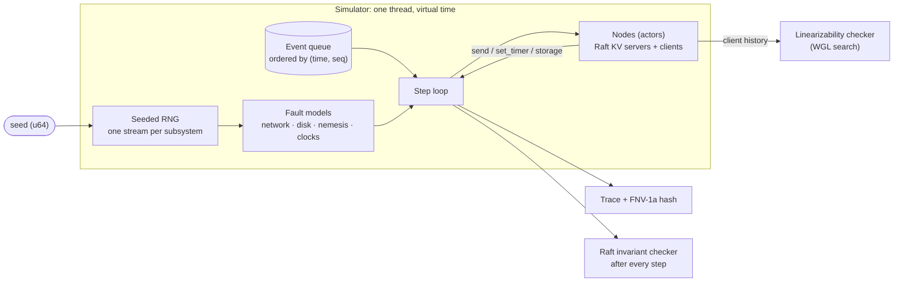

# dst-sim

A **deterministic simulation testing** framework in Rust, inspired by FoundationDB and TigerBeetle's VOPR.

It runs a whole distributed cluster on one thread in virtual time, injects network partitions,
message loss, node crashes, clock drift and disk faults, and makes every run reproducible from a
single 64-bit seed. The system under test is a Raft-replicated key-value store. Every run is
checked step by step against Raft's safety properties and, at the end, for linearizability.

> **Status:** core complete (milestones M1–M5). Next: parallel seed sweeps, a planted-bug suite,
> failure shrinking and a trace viewer. See [docs/ROADMAP.md](docs/ROADMAP.md).

## Results

10,000 seeds of full chaos against a 5-server Raft cluster with 2 clients (release build, one core):

| | |
|---|---|
| Seeds | 10,000 — **0 safety violations, 0 linearizability violations, every client finished** |
| Wall-clock time | ~13 s |
| Faults injected | 18,429 crashes · 42,511 partitions · 801,069 lost messages · 18,219 `fsync` failures · 18,149 crashes mid-`fsync` · 3,111 torn writes |
| Determinism | same seed → bit-identical trace, verified on Linux and Windows in CI |

## Bugs it catches

Each of these is planted (or was found during development) and is detected automatically:

| Bug | Caught by | Seeds needed |
|---|---|---|
| Acknowledging a write before `fsync` | durability check after crash | < 20 |
| Retrying a failed `fsync` and trusting the retry ("fsyncgate", PostgreSQL 2018) | durability check after crash | < 300 |
| Serving reads from a replica's local copy (stale reads) | linearizability checker | 1 |
| A restarted node receiving messages before it had recovered from disk | Raft invariant checker | 1 (found while building the framework) |

## How it works



**Determinism.** Nodes are event handlers that touch the world only through a `Context` trait:
send a message, set a timer, read the clock, use the disk. The simulator owns time, delivers
events in `(virtual time, sequence number)` order, and draws every random choice (latency, loss,
crashes, election timeouts) from ChaCha8 streams derived from the seed, one stream per subsystem
so that changing one doesn't reshuffle another. A clippy lint bans wall-clock time, threads and
`HashMap` in simulated code. Each run is fingerprinted by a portable FNV-1a hash of its events;
two golden-hash tests pin exact runs across operating systems.

**Fault model.**

| Layer | Faults |
|---|---|
| Network | loss, duplication, delay spikes (reordering), symmetric and one-way partitions |
| Nodes | crash and restart (memory and timers lost), supervisor restart after a self-halt |
| Clocks | per-node offset and drift (up to ±5%) |
| Disk | unsynced writes lost or partly kept on crash, torn writes, `fsync` failure (writes dropped, as on Linux), crash in the middle of `fsync` |

A Jepsen-style nemesis applies partitions and crashes for the first 10 s of virtual time, then
heals everything so the checks can confirm the cluster recovers.

**System under test.** Raft (election, replication, commit rules from Figure 2 of the paper) with
durable term, vote and log, plus a key-value store with `get` / `put` / `cas`. All operations go
through the log; client sessions with sequence numbers make retries exactly-once.

**Checking.** After every step: election safety, state machine safety, leader completeness and
never-lost committed entries. After every run: the clients' recorded history must be
linearizable (Wing & Gong search with memoisation, partitioned per key). Operations whose outcome
is unknown (client timed out or crashed) may or may not have taken effect.

## Try it

```bash
# All tests (a few seconds)
cargo test --workspace

# Watch a gossip protocol under chaos; same seed, same output
cargo run -p sim-core --example gossip -- 42 5 chaos

# The 10,000-seed Raft sweep
cargo test --release -p kv --test cluster -- --ignored
```

## Layout

| Crate | Role |
|---|---|
| `sim-api` | What a system under test can use: `Node`, `Context`, `Storage`, virtual time, checksummed records |
| `sim-core` | Simulator: RNG streams, event queue, step loop, nemesis, clocks, trace |
| `sim-net` | Network fault model |
| `sim-disk` | Disk fault model with page-cache semantics |
| `raft` | Raft consensus, written only against `sim-api`, plus its invariant checker |
| `kv` | Replicated key-value store, retrying clients, sequential model for checking |
| `checker` | Generic linearizability checker |
| `dst-cli` | `dst` command-line tool (in progress) |

## References

- D. Ongaro and J. Ousterhout, *In Search of an Understandable Consensus Algorithm* (Raft), 2014
- W. Wilson, *Testing Distributed Systems w/ Deterministic Simulation*, Strange Loop 2014
- TigerBeetle, *VOPR* simulation testing
- J. Wing and C. Gong, *Testing and Verifying Concurrent Objects*, 1993; A. Athalye, *Porcupine*
- K. Kingsbury, Jepsen analyses
