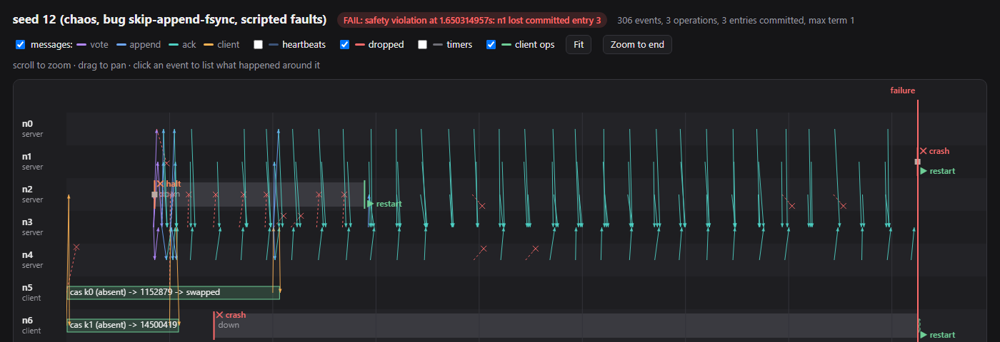
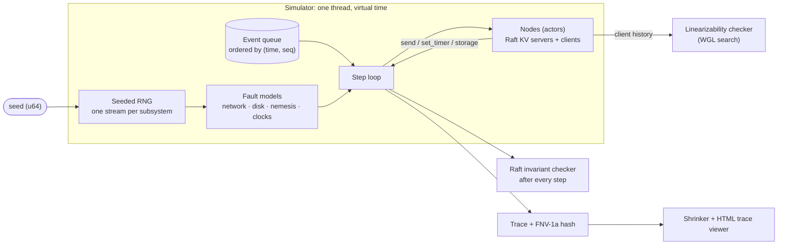

# dst-sim

A **deterministic simulation testing** framework in Rust, inspired by FoundationDB and TigerBeetle's VOPR.

It runs a whole distributed cluster on one thread in virtual time, injects network partitions,
message loss, node crashes, clock drift and disk faults (including corruption), and makes every
run reproducible from a single 64-bit seed. The system under test is a Raft-replicated key-value
store with snapshots and linearizable reads. Every run is checked step by step against Raft's
safety properties and, at the end, for linearizability. A failing run shrinks to a minimal
scenario that opens in a trace viewer, and the same Raft code also runs as real processes over
TCP.

> **Status:** complete through milestone M8 (simulator, faults, Raft KV, linearizability
> checking, bug-hunting CLI, shrinking, trace viewer, disk corruption, ReadIndex, snapshots, real
> mode). See [docs/ROADMAP.md](docs/ROADMAP.md) and the [bug museum](docs/BUG_MUSEUM.md).

## Results

A 5-server Raft cluster with 2 clients, release build on 16 threads:

| | Chaos (fixed fault mix) | Swarm (random fault mix per seed) |
|---|---|---|
| Seeds | 200,000 | 300,000 |
| Result | **all pass**: no safety or linearizability violation, every client finished | **all pass** |
| Wall-clock time | 42 s (≈4,800 seeds/s) | 72 s (≈4,100 seeds/s) |
| Simulated time | 349 cluster-hours, 383 M events | 525 cluster-hours, 618 M events |
| Crashes / self-halts | 386,649 / 1,008,286 | 1,350,576 / 3,229,331 |
| Partitions | 900,167 | 1,823,583 |
| Lost / duplicated messages | 15.8 M / 6.0 M | 22.8 M / 20.5 M |
| `fsync` failures / crashes mid-`fsync` / torn writes | 504,059 / 504,227 / 76,149 | 1,608,647 / 1,620,684 / 348,223 |
| Corrupted disks (all detected and repaired) | 38,050 | 144,579 |

**Real mode.** The same Raft and store code runs as separate processes over TCP and real files
(`dst serve`, `dst client`). A test starts three servers and keeps `kill -9`-ing and restarting
them, one at a time, while a client writes; the client's history then passes the same
linearizability checker. A 400-operation run survived 99 kills.

**Speed.** One thread simulates the 7-node cluster (5 servers, 2 clients) about **3,900x faster
than real time**: 1.2 M events/s, about 610 seeds/s, each seed 6.3 s of simulated time on
average. All 16 hardware threads together reach about 30,000x.

Determinism: the same seed gives a bit-identical trace, verified on Linux and Windows in CI. Every
push runs a 10,000-seed chaos sweep and a 2,000-seed swarm sweep; a nightly job sweeps 200,000
swarm seeds it has never run before (about 350 simulated cluster-hours).



*A shrunk failure in the trace viewer (`dst run --html`): nodes are lanes, arrows are messages
from send to arrival, red crosses are lost messages. Here 11 faults shrank to 2: a server that
acknowledged entries without `fsync` crashes (right) and comes back without an entry that was
already committed.*

## Bugs it catches

**Planted bugs** (mutation testing). Each is a real mistake, behind a flag; the table shows the
mean number of seeds needed to catch it, measured over 10,000 seeds per bug with `dst bugs`.

| Bug | Chaos | Swarm | Caught by |
|---|---|---|---|
| Follower truncates its log even when entries match (stale messages erase entries) | 1.1 | 1.5 | Raft invariants |
| Appended entries acknowledged without `fsync` | 1.7 | 1.9 | Raft invariants |
| Votes granted without the "candidate's log is up to date" check | 2.2 | 3.0 | Raft invariants |
| Replicas answer reads from their own, possibly stale, copy | 6.8 | 4.4 | linearizability |
| A corrupted log is cut short and trusted, so the node keeps voting | 26 | 11 | Raft invariants |
| Snapshots leave out the client session table, so retries apply twice | 1 in 10,000 | 357 | linearizability |
| The leader serves reads without confirming it still leads | 769 | 1 in 10,000 | linearizability |
| Follower commits past the entries a message verified (a Figure 2 subtlety) | not yet | 2,000 | Raft invariants |
| Vote kept in memory but not persisted | not yet | 1 in 10,000 | Raft invariants |
| Leader commits earlier-term entries by counting replicas (Figure 8) | not yet | not yet | — |
| Truncate and append share one `fsync` | not yet | not yet | — |

The rare ones need a precise sequence: a deposed leader still serving a read after a new leader
took a write, a vote request re-delivered after the voter restarted, Figure 8 of the Raft paper.
Swarm and chaos complement each other; targeted scenarios for the last two are future work.

**The corruption defence is necessary.** With the per-node check relaxed, trusting a damaged log
leads to real cluster-wide failures (a leader elected without an already committed entry, in 14
of 20,000 swarm seeds and 4 of 20,000 chaos seeds), while the correct code passes the same seeds.

**Durability bugs** in a toy write-ahead log: acknowledging before `fsync` (< 20 seeds) and
trusting a retried `fsync` after a failure ("fsyncgate", PostgreSQL 2018; < 300 seeds).

**Found while building it.** The simulator found real bugs in this repository's own Raft,
storage format, simulator and checkers; [docs/BUG_MUSEUM.md](docs/BUG_MUSEUM.md) has each one
with its seed, cause and fix. Some highlights:
- After a failed `fsync` the node halts, but the rest of that event kept writing to disk and
  synced a record after the dropped one: fsyncgate in our own code. Halting now cuts off storage.
- A crash between switching to a new snapshot and recording the new log end made recovery report
  damage that wasn't there; three servers stopped voting and the cluster never elected a leader
  again. Found as one liveness failure in 100,000 seeds, then directly by a new check that fails
  any run where a server claims disk damage the simulator never caused.
- A misplaced write can cover several records at once, so a damaged log end looked exactly like
  a torn write. Log length now lives in a separate file.
- A cut-off node won an *older* term through delayed votes after a newer term had committed an
  entry it lacked. Raft allows that; the invariant checker was too strict.

## How it works



**Determinism.** Nodes are event handlers that touch the world only through a `Context` trait:
send a message, set a timer, read the clock, use the disk. The simulator owns time, delivers
events in `(virtual time, sequence number)` order, and draws every random choice (latency, loss,
crashes, election timeouts) from ChaCha8 streams derived from the seed, one stream per subsystem
so that changing one doesn't reshuffle another. A clippy lint bans wall-clock time, threads and
`HashMap` in simulated code. Each run is fingerprinted by a portable FNV-1a hash of its events;
two golden-hash tests pin exact runs across operating systems.

**Fault model.**

| Layer | Faults |
|---|---|
| Network | loss, duplication, delay spikes (reordering), symmetric and one-way partitions |
| Nodes | crash and restart (memory and timers lost), supervisor restart after a self-halt |
| Clocks | per-node offset and drift (up to ±5%) |
| Disk | unsynced writes lost or partly kept on crash, torn writes, `fsync` failure (writes dropped, as on Linux), crash in the middle of `fsync`, corruption at rest (a flipped bit, or a span of bytes in the wrong place) |

A Jepsen-style nemesis applies partitions and crashes for the first 10 s of virtual time, then
heals the network, restarts every node and makes disks reliable, so the checks can confirm the
cluster recovers. Corruption stays within what a replicated system can survive: at most a minority
of servers, each once per run.

**Swarm testing.** In swarm mode every seed also picks which faults are on and how hard they hit
(loss, duplication, delay spikes, partitions, crashes, clock drift, each disk fault, nemesis pace),
from its own random stream. A single fixed mix tends to hide bugs that need one fault to be absent
so another can reach a rare state.

**BUGGIFY.** Raft and the store contain FoundationDB-style hooks that, in simulation, occasionally
take rare but correct paths: one-entry batches, skipped heartbeats, minimum election timeouts,
ignoring a rejection's hint, delayed replication and read confirmation, re-proposing retried
requests, impatient client retries, compacting after every entry. Outside simulation they are
always off.

**System under test.** Raft (election, replication, commit rules from Figure 2 of the paper) with
a key-value store doing `get` / `put` / `cas`:
- *Writes* go through the log; client sessions with sequence numbers make retries exactly-once.
- *Reads* use ReadIndex (Raft thesis §6.4): the leader confirms it still leads with one round of
  heartbeats, then answers from its own state, without writing to the log.
- *Snapshots* compact the log every 32 entries; a follower too far behind gets `InstallSnapshot`.
  The log alternates between two files and a checksummed snapshot record is the atomic switch,
  so a crash at any point leaves one complete log.
- *Durability*: term and vote are kept in two copies; log entries carry their own index; the last
  synced entry is recorded separately. Recovery tells a torn write (never acknowledged, safe to
  drop) from corruption of synced data. A server that lost acknowledged entries becomes a
  non-voter until it holds an entry from a newer leader, which by Raft's own proof holds every
  committed entry (in the spirit of protocol-aware recovery, Alagappan et al., FAST 2018).

**Checking.** After every step, all five safety properties of Figure 3 of the Raft paper: election
safety, log matching (via prefix hashes of every `(index, term)` ever seen), leader completeness,
state machine safety, and committed entries never lost (except, knowingly, on a server repairing
corruption). The harness also fails a run if a server claims disk damage the simulator never
caused. After every run: the clients' recorded history must be linearizable (Wing & Gong search
with memoisation, partitioned per key). Operations whose outcome is unknown (client timed out or
crashed) may or may not have taken effect.

**Shrinking.** `dst shrink` writes a failing run's fault schedule out and replays it in place of
the random nemesis (bit-identical: restart delays have their own random stream). It then deletes
faults with delta debugging, switches off whole fault types, drops clients and operations, and
ends the fault period earlier, keeping each change only if the run still fails the same way.
Over 42 failing seeds (up to five per planted bug) it took 0.1–2 s and about 110 simulations
each. Faults fell 3x at the median (618 → 213 in total; 11 runs needed no faults at all, and
81 → 7 and 18 → 1 were among the best), while event counts fell only 1.3x at the median (6.3x at
best), because with fewer faults a failure can take longer to show. Rare, timing-sensitive failures shrink least: deleting any
fault changes every later interleaving. The output is a small text scenario file that
`dst run --scenario` replays.

**Trace viewer.** `dst run --html run.html` writes a single self-contained page (no dependencies)
with the run built in: a space-time diagram on a canvas, zoom and pan, hover for any event, the
operations of a non-linearizable key outlined in red.

## Try it

```bash
# All tests, including the real-process kill test
cargo test --workspace

# Watch a gossip protocol under chaos; same seed, same output
cargo run -p sim-core --example gossip -- 42 5 chaos

# The dst tool (build once)
cargo build --release -p dst-cli

# Run one seed; on failure it prints the commands that replay and shrink it
./target/release/dst run --seed 42 --mode chaos

# Plant a bug, catch it, shrink it, and look at it
./target/release/dst run --seed 12 --mode chaos --bug skip-append-fsync
./target/release/dst shrink --seed 12 --mode chaos --bug skip-append-fsync --out shrunk.txt
./target/release/dst run --scenario shrunk.txt --html shrunk.html

# Sweep seeds in parallel on every core
./target/release/dst sweep --seeds 0..100000 --mode swarm

# The planted-bug table above
./target/release/dst bugs --seeds 10000 --mode chaos

# A real cluster: three servers and a client on localhost (one terminal each)
./target/release/dst serve --id 0 --nodes 7000-7003 --data data/n0
./target/release/dst serve --id 1 --nodes 7000-7003 --data data/n1
./target/release/dst serve --id 2 --nodes 7000-7003 --data data/n2
./target/release/dst client --id 3 --nodes 7000-7003 --ops 500
```

Modes: `calm` (no faults), `chaos` (every fault, fixed intensity), `swarm` (random mix per seed).
Bugs: `local-reads`, `vote-without-log-check`, `forget-vote`, `truncate-without-conflict`,
`commit-beyond-match`, `skip-append-fsync`, `commit-old-terms`, `single-sync-truncate`,
`trust-damaged-log`, `read-without-quorum`, `snapshot-without-sessions`.

## Layout

| Crate | Role |
|---|---|
| `sim-api` | What a system under test can use: `Node`, `Context`, `Storage`, virtual time, checksummed records, wire encoding |
| `sim-core` | Simulator: RNG streams, event queue, step loop, nemesis and fault scripts, clocks, trace |
| `sim-net` | Network fault model |
| `sim-disk` | Disk fault model with page-cache semantics and corruption |
| `raft` | Raft consensus with ReadIndex and snapshots, written only against `sim-api`, plus its invariant checker |
| `kv` | Replicated key-value store, retrying clients, sequential model for checking |
| `checker` | Generic linearizability checker |
| `harness` | Runs a checked cluster for one seed; scenarios and the shrinker |
| `runtime-real` | The same `Context` over TCP, real files and the real clock |
| `dst-cli` | `dst` command-line tool: `run`, `sweep`, `bugs`, `shrink`, `serve`, `client` |

`viewer/index.html` is the trace viewer (it also opens JSON from `dst run --json`).
`.github/workflows` holds CI (format, lint, tests and docs on Linux and Windows), the seed sweeps,
and an on-demand CPU flamegraph of a one-thread sweep (`Profile`, run by hand).

## References

- D. Ongaro and J. Ousterhout, *In Search of an Understandable Consensus Algorithm* (Raft), 2014;
  D. Ongaro, *Consensus: Bridging Theory and Practice* (PhD thesis, ReadIndex in §6.4), 2014
- W. Wilson, *Testing Distributed Systems w/ Deterministic Simulation*, Strange Loop 2014
- TigerBeetle, *VOPR* simulation testing
- J. Wing and C. Gong, *Testing and Verifying Concurrent Objects*, 1993; A. Athalye, *Porcupine*
- A. Groce et al., *Swarm Testing*, ISSTA 2012
- A. Zeller and R. Hildebrandt, *Simplifying and Isolating Failure-Inducing Input* (delta debugging), 2002
- R. Alagappan et al., *Protocol-Aware Recovery for Consensus-Based Storage*, FAST 2018
- K. Kingsbury, Jepsen analyses
